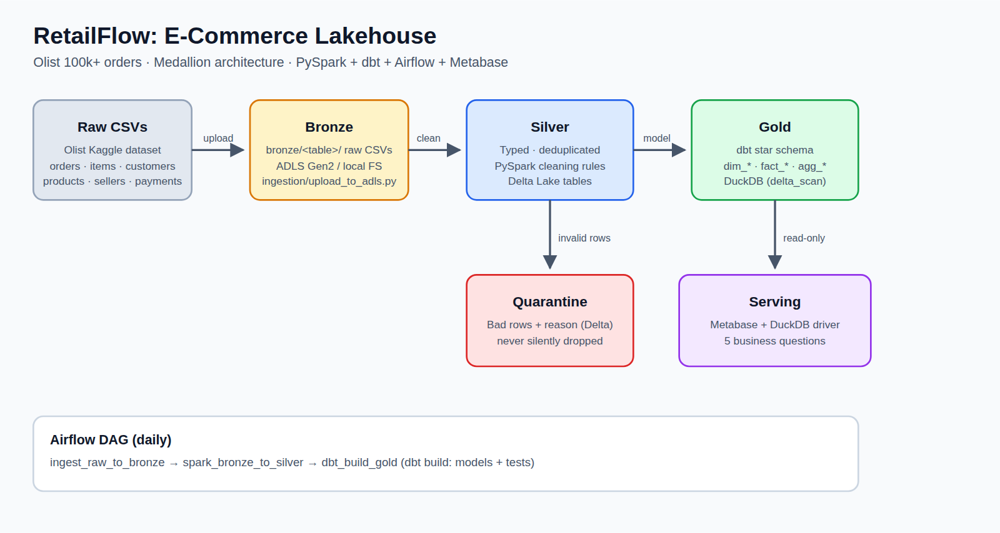
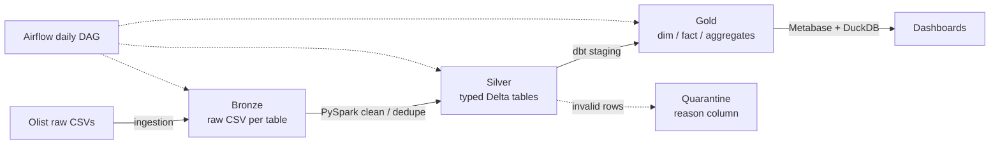
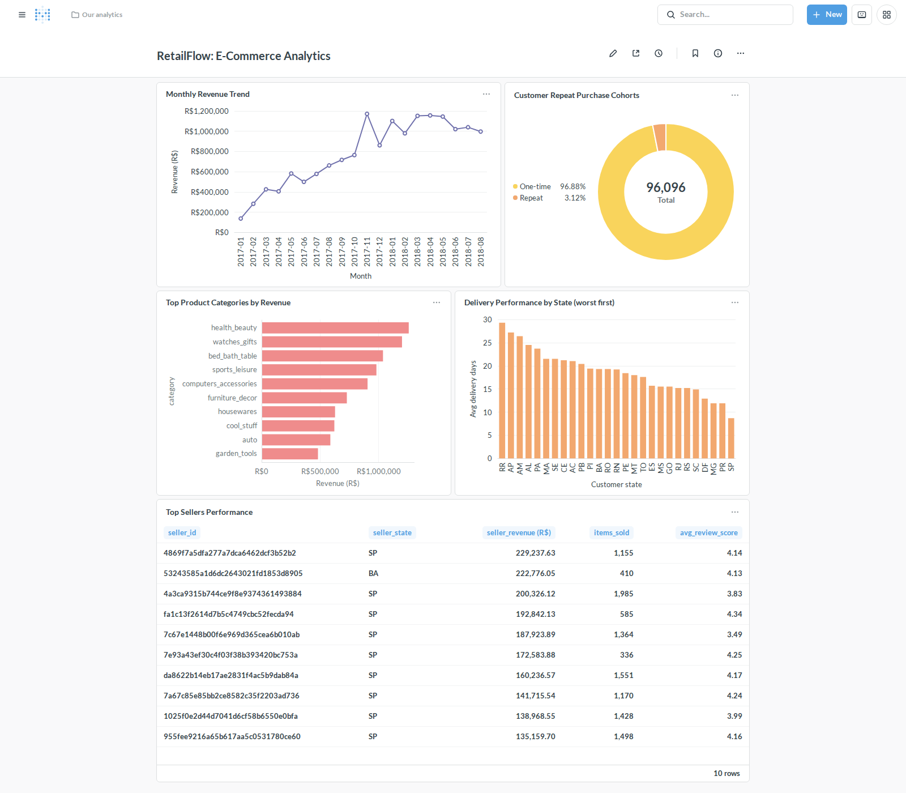

# RetailFlow: E-Commerce Lakehouse Pipeline

[](https://github.com/v0rein/DE/actions/workflows/ci.yml)
[](https://www.python.org/)
[](https://spark.apache.org/docs/latest/api/python/)
[](https://www.getdbt.com/)
[](https://airflow.apache.org/)
[](https://www.metabase.com/)

End-to-end data lakehouse processing **99,441 Brazilian e-commerce orders** through a Medallion architecture (Bronze → Silver → Gold), modeled into a star schema with dbt, orchestrated with Apache Airflow, and served in Metabase.

## Architecture



Editable source: [`docs/architecture.svg`](docs/architecture.svg).



**Pipeline flow**

1. **Bronze:** `ingestion/upload_to_adls.py` uploads each raw CSV to its own table folder, `bronze/<table>/<file>.csv` (e.g. `bronze/orders/olist_orders_dataset.csv`), on ADLS Gen2 or a local folder when `USE_LOCAL_STORAGE=true`. The file → table mapping (`BRONZE_TABLES`) is shared with the Spark job. The geolocation CSV is skipped because no model uses it.
2. **Silver:** `spark_jobs/bronze_to_silver.py` reads the Bronze CSVs, casts types, null-checks business keys, applies accepted-value rules, deduplicates, and writes **Delta Lake** tables to `silver/<table>/`. Bad rows (including uncastable values and duplicate keys) go to the Delta table `bronze/quarantine/<table>/` with a `quarantine_reason` column. Delta commits each overwrite through `_delta_log/`, so a crashed run leaves the previous version readable instead of an empty folder.
3. **Gold:** dbt reads Silver with DuckDB's `delta` extension (`delta_scan`) and builds 7 staging views, 4 dimensions, 2 facts, and 6 business aggregates in DuckDB, backed by 63 data-quality tests.
4. **Serving:** Metabase connects to the DuckDB warehouse through the community DuckDB driver; `dashboard/setup_metabase.py` builds the dashboard from the queries in `dashboard/queries.sql`.

## Business Questions Answered

| # | Question | Gold model |
|---|---|---|
| 1 | What is the monthly revenue trend? | `agg_revenue_by_month` |
| 2 | Which product categories generate the most revenue? | `agg_revenue_by_category` |
| 3 | Which months and states have the worst delivery performance? | `agg_delivery_performance`, `agg_delivery_by_state` |
| 4 | How many customers buy more than once? | `agg_customer_retention` |
| 5 | Who are the top sellers by revenue and review score? | `agg_seller_performance` |

### Results from the verified local run

| Metric | Value |
|---|---|
| Orders processed | 99,441 |
| Order lines | 112,650 |
| Sellers | 3,095 |
| Total item + freight revenue (excl. canceled/unavailable) | R$ 15,735,527.03 |
| Highest-revenue category | `health_beauty`, R$ 1,255,695.13 |
| Slowest-delivery state | `RR`, 29.3 average days |
| Late-delivery rate (delivered orders) | 6.8% |
| Top seller | R$ 229,237.63 revenue, 4.14 average review score |
| Repeat-buyer rate | 3.1% (Olist is dominated by one-off customers) |

The dashboard's revenue chart covers **2017-01 to 2018-08**. The months where the dataset starts and ends (2016-09, 2016-10, 2016-12, 2018-09) have only 1–293 orders each, so the chart skips months with fewer than 500 orders. Without that cut, the last month looks like a revenue crash. The Gold model `agg_revenue_by_month` still keeps every month, and the R$ 15,735,527.03 total above includes all of them.

## Tech Stack

| Layer | Tool |
|---|---|
| Ingestion | Python, `azure-storage-blob` |
| Processing | PySpark 3.5 |
| Silver storage | Delta Lake 3.2 (`delta-spark`; local filesystem, ADLS Gen2 upload path included) |
| Warehouse | DuckDB 2.0 + `delta` extension |
| Transformation | dbt-core 1.8 + dbt-duckdb 1.8 |
| Orchestration | Apache Airflow 2.9 (Docker) |
| Serving | Metabase + DuckDB community driver |
| Testing | pytest, dbt data tests |
| CI | GitHub Actions |

## Repository Layout

```text
.
├── ingestion/upload_to_adls.py      # Bronze upload (ADLS or local)
├── spark_jobs/bronze_to_silver.py   # Silver cleaning + quarantine
├── dbt/
│   ├── models/staging/              # Silver sources + typed staging views
│   ├── models/marts/                # dim_*, fact_*
│   ├── models/aggregates/           # agg_* business marts
│   ├── dbt_project.yml
│   └── profiles.yml
├── airflow/
│   ├── dags/retailflow_dag.py       # Daily 3-task pipeline
│   ├── Dockerfile
│   └── docker-compose.yml
├── dashboard/
│   ├── queries.sql                  # Six business queries (Q1-Q6)
│   ├── setup_metabase.py            # Builds the dashboard through the Metabase API
│   └── docker-compose.yml           # Metabase + DuckDB driver
├── docs/architecture.png           # Rendered diagram (source: architecture.svg)
├── docs/dashboard.png              # Metabase dashboard screenshot
├── terraform/                       # Optional ADLS Gen2 + resource group
├── tests/                           # pytest unit + integration tests
├── requirements.txt
└── requirements-airflow.txt
```

## Quickstart

### 1. Install

Requires **Python 3.11** (PySpark 3.5 does not support 3.13) and **Java 11+**.

```bash
conda create -n retailflow python=3.11 -y
conda activate retailflow
pip install -r requirements.txt
```

> **Windows only:** Spark needs Hadoop's `winutils.exe`. Download the Hadoop 3.3.x binaries from [cdarlint/winutils](https://github.com/cdarlint/winutils), set `HADOOP_HOME` to that folder, and add `%HADOOP_HOME%\bin` to `PATH`. Linux, macOS, Docker, and CI need no extra setup.

### 2. Run the test suite

```bash
pytest tests/ -v
```

The Airflow DAG test is skipped unless Apache Airflow is installed:

```bash
pip install -r requirements-airflow.txt
airflow db migrate
pytest tests/test_airflow_dag.py -v
```

### 3. Build Bronze and Silver

Place the [Olist CSVs](https://www.kaggle.com/datasets/olistbr/brazilian-ecommerce) in `data/raw/`, then:

```bash
python -m ingestion.upload_to_adls all bronze data/raw
python -m spark_jobs.bronze_to_silver
```

The first Spark run downloads the `delta-spark` jar from Maven (a few MB). Without `winutils` on Windows, run the Spark step in the Airflow container instead:

```bash
(cd airflow && docker compose run --rm airflow-standalone bash -c "cd /opt/airflow && python -m spark_jobs.bronze_to_silver")
```

Expected output:

```text
orders: 99441 clean, 0 quarantined
order_items: 112650 clean, 0 quarantined
customers: 99441 clean, 0 quarantined
products: 32951 clean, 0 quarantined
sellers: 3095 clean, 0 quarantined
payments: 103886 clean, 0 quarantined
reviews: 99224 clean, 0 quarantined
product_category_translation: 71 clean, 0 quarantined
```

### 4. Build and test the Gold layer

```bash
(cd dbt && dbt build --profiles-dir .)
```

Expected: `PASS=82 WARN=0 ERROR=0` (19 models + 63 tests).

### 5. Orchestrate with Airflow

> **Linux hosts (Docker Engine):** bind mounts keep the host user's ownership, but Airflow runs as uid 50000 and Metabase as uid 999. Without this, Airflow gets `Permission denied` on `data/` and `dbt/`, and Metabase crash-loops because it can't create `metabase-data/`. Run once from the repo root, after steps 3 and 4, then run Spark and dbt through Airflow instead of on the host. Docker Desktop (Windows/macOS) needs none of this.
>
> ```bash
> mkdir -p data dashboard/metabase-data && sudo chown -R 50000:0 data dbt && sudo chown 999 dashboard/metabase-data
> ```

```bash
(cd airflow && docker compose up -d --build)
```

Open <http://localhost:8080> and log in as `admin`. Standalone mode generates a random password on first start; print it with:

```bash
docker exec retailflow-airflow cat /opt/airflow/standalone_admin_password.txt
```

Then trigger `retailflow_lakehouse_pipeline`. The DAG runs ingestion → Spark → `dbt build` (task `dbt_build_gold`) with `retries=2`, a 1-hour `execution_timeout` per task, and `max_active_runs=1`. `dbt build` runs each model's tests right after building it, and a failing test skips every model downstream of it.

#### Failure alerts

Every task emails `ALERT_EMAIL` when it fails for good (after its retries; no email on retry). Copy `.env.example` to `.env`, fill in `ALERT_EMAIL` and the `AIRFLOW__SMTP__*` keys (a Gmail App Password works for testing), then start Airflow with that file:

```bash
(cd airflow && docker compose --env-file ../.env up -d --build)
```

To verify the SMTP settings, send a test email from inside the container:

```bash
docker exec retailflow-airflow python -c "import os; from airflow.utils.email import send_email; send_email(os.environ['ALERT_EMAIL'], 'RetailFlow test', 'SMTP works')"
```

With `ALERT_EMAIL` unset, the DAG still loads and simply sends no email.

### 6. Serve in Metabase



The image is pinned to `ghcr.io/motherduckdb/metabase-duckdb:0.63.17-duckdb1.5.6.0` (Metabase 0.63.17 + DuckDB driver 1.5.6.0) so an upstream `:latest` change can't break the dashboard.

```bash
(cd dashboard && docker compose up -d)
export MB_ADMIN_EMAIL=you@example.com MB_ADMIN_PASSWORD='RetailFlow-demo-2026'
python dashboard/setup_metabase.py
```

Metabase rejects common passwords.

The script (stdlib only) waits for Metabase, creates the admin user on first start, adds the DuckDB database `/data/lakehouse/retailflow.duckdb` with the driver's **read-only** option on, builds one card per business question from [`dashboard/queries.sql`](dashboard/queries.sql), and lays them out on the dashboard **RetailFlow: E-Commerce Analytics**. It looks everything up by name, so re-running it updates the cards instead of duplicating them. Open the URL it prints (e.g. <http://localhost:3000/dashboard/2>).

The lakehouse folder is mounted read-only (`:ro`), so a read-write Metabase connection would fail. A read-only DuckDB connection still locks the file: after a dashboard query, Metabase holds the lock for about 10 minutes (measured), and any `dbt build` in that window fails with a lock error. The DAG's `dbt_build_gold` task retries twice, 10 minutes apart, which outlasts it. For a manual `dbt build` on the host, wait 10 minutes after using the dashboard, or stop Metabase first (`cd dashboard && docker compose stop`).

## Data Quality

- **Silver rules:** null business keys, invalid order status, invalid payment type/value, invalid review scores, negative prices/freight, and duplicate keys.
- **Quarantine:** rejected rows, including extra copies of a duplicate key (`duplicate_key`), are persisted with `quarantine_reason`, never silently dropped. Bronze rows always equal clean + quarantined.
- **Revenue rule:** every revenue number excludes `canceled` and `unavailable` orders via `fact_orders.is_revenue_order`.
- **dbt tests:** 63 tests covering `not_null`, `unique`, `accepted_values`, and `relationships` between facts and dimensions.
- **CI:** pytest, dbt compilation, and a dedicated Airflow DAG-structure job.

## Azure Notes

Set the following in `.env` to upload Bronze to ADLS Gen2 instead of the local filesystem:

```env
USE_LOCAL_STORAGE=false
AZURE_STORAGE_CONNECTION_STRING=DefaultEndpointsProtocol=https;AccountName=...;AccountKey=...;EndpointSuffix=core.windows.net
AZURE_CONTAINER_NAME=retailflow
```

The verified processing/serving profile in this repository is local Delta Lake + DuckDB. Running Spark and dbt directly against ADLS would require adding the Hadoop Azure jars and a `dbt-spark` profile; see the roadmap below.

## Provision Azure (optional)

`terraform/` creates a resource group, a StorageV2 account with hierarchical namespace (ADLS Gen2, Standard LRS, TLS 1.2, no public blob access), and a `retailflow` filesystem. Nothing in the local pipeline needs it.

```bash
az login
export ARM_SUBSCRIPTION_ID=$(az account show --query id -o tsv)
cd terraform
cp terraform.tfvars.example terraform.tfvars   # set a globally unique storage_account_name
terraform init
terraform plan
terraform apply
```

Cost: ADLS Gen2 LRS at this data size (well under 1 GB) costs cents per month. `terraform destroy` removes everything it created.

## Roadmap

- Incremental Silver loads with Delta `MERGE` instead of full overwrites.
- `dbt-spark` profile for warehouse-native Gold builds on ADLS.
- Slack callbacks on Airflow failure (email alerts already ship).

## Dataset

[Brazilian E-Commerce Public Dataset by Olist](https://www.kaggle.com/datasets/olistbr/brazilian-ecommerce): 9 CSVs, ~100k orders (2016–2018). Prices are in BRL. The data is licensed [CC BY-NC-SA 4.0](https://creativecommons.org/licenses/by-nc-sa/4.0/) and isn't redistributed in this repo (`data/` is gitignored); download it from Kaggle.

## License

Code: [MIT](LICENSE).
